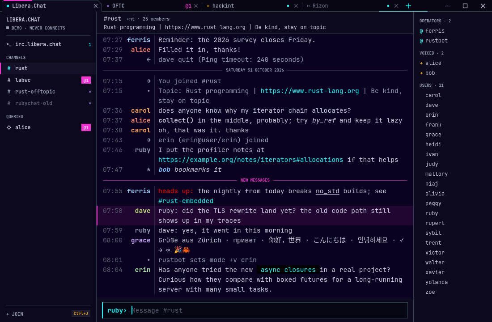

  

<h1 align="center">RubyChat</h1>

<em>A sparkly little IRC client that never keeps you waiting. ♡</em>

RubyChat is a desktop IRC client for Linux and Windows, written in Rust. It
draws every pixel itself, so typing, scrolling and switching channels stay
instant, even on the busiest network.

## ♡ What's inside

- **All your networks in one window**, one tab each, with channels and
  private chats in the sidebar.
- **Modern IRC**: TLS, SASL logins, history from the server, read markers
  and plenty of IRCv3.
- **Find things fast**: search a channel with Ctrl+F, hop anywhere with
  Ctrl+K, and browse a server's channels with `/list`.
- **Never miss a ping**: close the window and RubyChat waits in the tray,
  with a notification when someone says your name.
- **Pretty text**: colors, clickable links, emoji, and Chinese, Japanese
  and Korean alongside your own.

## ♡ Get it

Download from [Releases](https://github.com/RubyMaelstrom/RubyChat/releases):

- **Linux**: unpack `rubychat-linux-x86-64.tar.gz` (or `-arm64`) and run
  `./rubychat`. `./install.sh` adds it to your app menu.
- **Windows**: unzip `rubychat-windows-x86-64.zip` and run `rubychat.exe`.
  `rubychat.exe --register` makes `irc://` links open in it.

Or build it yourself with `cargo build --release`.

Type a server like `irc.libera.chat` on the start page, then
`/join #channel`. `/help` lists the rest.

## ♡ License

[MPL-2.0](LICENSE.md). The chat font, JetBrains Mono, is under the
[SIL Open Font License](assets/fonts/JetBrainsMono-OFL.txt).
